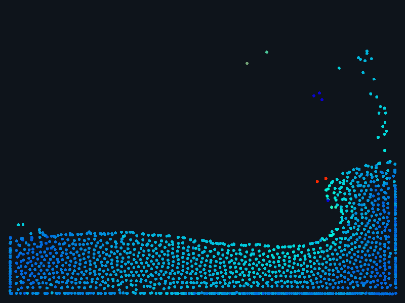
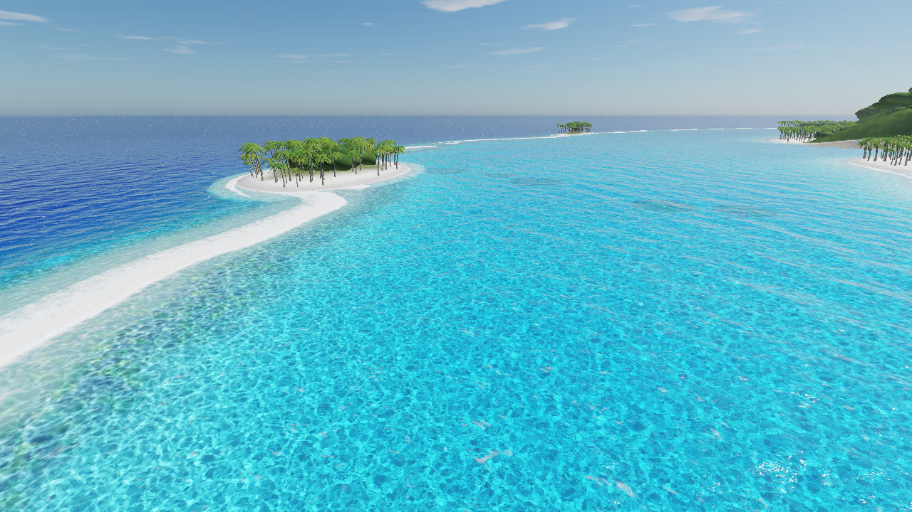

# SPH Liquid

A real-time 2D fluid simulation you can poke, tilt and splash — smoothed-particle
hydrodynamics (Müller 2003: poly6 density, spiky pressure, viscosity laplacian)
in a few hundred lines of plain JavaScript on a canvas. No framework, no build
step, no dependencies.



It's an installable PWA: offline-capable service worker, app icon, fullscreen
mode that harmonizes with the browser's own, and device-tilt gravity on
phones and tablets.

## What's inside

- `sim.js` — the physics core (UMD: browser global + Node export). Weakly
  compressible SPH with a uniform spatial-hash grid and CSR neighbour table.
  Rest density is computed from the kernel's lattice sum at rest spacing, so
  pressure at rest is exactly zero by construction.
- `index.html` — the whole UI: slide-out options panel, brush/attract/repel
  controls, live particle count and resolution knobs, palettes, metaball
  rendering.
- `test.js` — headless physics assertions (settling energy, boundaries,
  neighbour search vs brute force, "is it a fluid *body*" regression, live
  resize, resolution rescale, surface tension).
- `shots.js` / `serve.js` — deterministic PNG screenshots, zero-dependency
  dev server.
- `sw.js` / `manifest.webmanifest` / `icons/` — PWA layer.

## Run it

Open `index.html` in a browser. Or for the full experience (install, offline,
sensors):

```
node serve.js        # prints a LAN URL for your phone
node test.js         # the physics suite
node shots.js        # regenerate screenshots
```

## Tuning invariants

If you adjust things, keep these true: particle size and smoothing radius stay
in a ~2.9 ratio, the CFL number `c·dt/h` stays near 0.2, and rest density comes
from the lattice sum, never a magic number. The comments in `sim.js` explain
why each one exists — they were learned the hard way.

Keys: `Space` pause · `R` re-dam · `G` gravity · `O` options · `F` fullscreen ·
`1/2/3` render mode.

## Clear Lagoon: the 3D ocean



`ocean.html` is a second, separate sim: a real-time 3D ocean around a
volcanic island that you can fly over, dive under, poke, throw things into
and drive a boat across. WebGL2, still no build step or dependencies.

**The water**

- **Open-sea waves** are Tessendorf's FFT ocean. A fetch-limited JONSWAP
  wind sea with finite-depth dispersion and the TMA shallow-water correction
  is split over three cascades (233 m, 36 m, 12 m tiles at 256²). The GPU
  advances the spectra and inverse-FFTs them every frame (Stockham radix-2,
  one fragment pass per stage) into choppy displacement, slopes, and a
  Jacobian that seeds whitecap foam.
- **Clear water**: each surface pixel refracts its view ray with Snell's law
  and traces it to the ground. Absorption is close to pure sea water, so the
  lagoon reads turquoise over sand and the open ocean deep blue.
- **Caustics** come from the same waves: a mesh of sun rays is refracted
  onto the floor and each triangle brightens by how much its area shrank.
- **Surf** (`world.js`): a 9.5 s swell arrives from the open ocean. Its
  arrival time is solved over the whole island with an eikonal fast-sweeping
  solver (finite-depth phase speed), so crests slow, bunch up and bend to meet
  every beach. Height follows Green's-law shoaling, the island's shadow, and
  breaking carried along each ray, so the reef shelters the lagoon. The
  profile turns cnoidal as it shoals, throws a lip at the break, becomes a
  whitewater bore and runs up the sand as swash, leaving it wet. Sets of
  bigger waves roll through every minute.
- **Interactive ripples**: a wave-equation height field on a 102 m grid that
  follows you rides on top of the ocean. Shores reflect it; your hand, splashes
  and the boat disturb it.

**The island** (`world.js`): a twin-peaked volcanic island with beaches, a
rocky point and a bay; a lagoon with coral heads; a barrier reef with palm
motus that opens to the swell on the windward side; the outer slope to 50 m.
About 2,000 coconut palms and 5,000 rainforest crowns, instanced with LOD,
swaying in the wind and casting shadows from a sun shadow map.

**The reef up close**: within ~40 m the coral rock gains finer relief
octave by octave, and colonies grow in as you approach: brain, staghorn,
table, sea fan, tube and boulder corals. `life.js` adds nine fish schools of
six species (boids that loop their coral head and scatter from you), green
turtles that surface to breathe, and spotted eagle rays over the sand.

**Things to do** (`play.js`, tools on the bar or keys `1`–`4`):

- **fly**: click for mouse look (or drag) · `WASD` move · `Space`/`E` up ·
  `Q`/`C` down · `Shift` fast · wheel speed.
- **touch**: drag through the water; right-drag looks.
- **throw**: click to throw a beach ball, coconut or rock (`X` picks). They
  float at their Archimedes draught, ride and drift with the swell, roll on
  the sand, and splash; rocks sink.
- **boat**: `W`/`S` throttle, `A`/`D` steer, drag to look around, `R` for a
  new boat. Planing, pitch and roll that follow the water, leans into turns,
  surfs waves, jumps crests, grounds on sand, leaves a wake and throws spray.
- **float**: you become a swimmer's head on the water, eyes ~35 cm up on a
  soft buoyancy spring, so you rise and fall a beat behind the swell and a
  bore that climbs faster than you can float dunks you. Wave faces push you
  along, `WASD` paddles, the view sways with the water, and `R` takes you
  back out past the break.
- **surf**: a shortboard out the back of the nearest break, facing the
  beach. `W` paddles (lying down, ~2 m/s), `A`/`D` turns. When a wave picks
  you up and you run down its face you pop up: the board planes, the fins
  grip, `A`/`D` carves (spray off the rail) and you ride at 20-30 km/h.
  Lose the wave and you sink back to paddling; nose-dive down a face too
  steep, or land a jump badly, and you go over the falls. `R` paddles back
  out.

Spray flies off splashes, the bow and the lips of breaking waves. `sound`
(or `M`) turns on a synthesised soundscape: surf roar and crashing lips near
you, wind, the outboard, splashes, and a muffled world under water.

Also: `N` night (Clear Lagoon II) · `P` pause · `R` reset view · `H` panel · `F` fullscreen. On touch: drag
to look, two-finger drag to fly, pinch to climb or dive; in touch mode one
finger is your hand, in boat mode it's the stick. The panel sets surf, wind,
fetch, choppiness, foam, clarity, caustics, sun, clouds and render quality.

```
node ocean-test.js   # spectrum, FFT, island and surf, reef life, floating and boat physics
```

## Clear Lagoon II (`v2/`)

`v2/ocean.html` is a copy of Clear Lagoon that pushes further, kept beside
the original so the two can be compared (the `v2 →` / `← v1` button opens
the other at the same spot and moment). Everything above still applies; v2
adds:

- **A simulated surf zone** (`v2/swe.js` is the CPU reference, the GPU runs
  the same scheme). A 205 m shallow-water grid (512², 0.4 m cells) follows
  you: staggered velocities, upwind mass fluxes, semi-Lagrangian advection,
  wet/dry fronts and bottom friction. Offshore (deeper than ~3 m) it is
  nudged toward the analytic swell; inside that line the water is free to
  shoal, steepen, break into bores, run up the sand and wash back. Floating
  things and the boat are carried by its currents. What you see is a
  hybrid: until a wave has broken it keeps the analytic shape, folded lip
  and all; the whitewater, swash and backwash after that are simulated.
  From high up the patch fades out and pauses.
- **A peeling reef break**: a coral ledge on the windward reef, set at an
  angle to the swell so waves break along it at ~10 m/s instead of all at
  once.
- **Curling lips**: where a front's crest stands high for the depth under
  it (the simulation's own breaker test), GPU particles (state in float
  textures) are thrown forward off the crest at the wave's speed, fly over
  the face and shatter into spray. They are drawn as a liquid surface in
  screen space: sphere depths, a bilateral blur, normals from the smoothed
  depth, then refraction, reflection, sunlight through the thin lip and foam
  as it aerates. The panel's `lip throw` sets how readily they form;
  `simulate the surf` switches back to the analytic waves.
- **Float** and **surf** (tools `5` and `6`, also in v1): here the surf
  currents carry you too, shoreward in the whitewater and back out with the
  backwash, and the board's fins and drag work against the moving water.
- **Night** (`N`, or the `night` slider): the moon takes the sun's place,
  with stars, the Milky Way, a moonlit glitter path and night-adapted colour,
  and crickets sing from the island.
- **Bioluminescence**: at night the plankton light up wherever the water is
  stirred, in breaking surf and bores, lips and spray, splashes, the boat's
  wake, ripples spreading from anything moving, and around swimming fish,
  turtles and rays. A fourth ripple channel remembers the stirring, so the
  glow flashes and fades over a second or two. `plankton glow` sets it.

```
node v2/ocean-test.js   # all of the above, plus shallow-water mass, lake at rest, breaking and run-up
```
